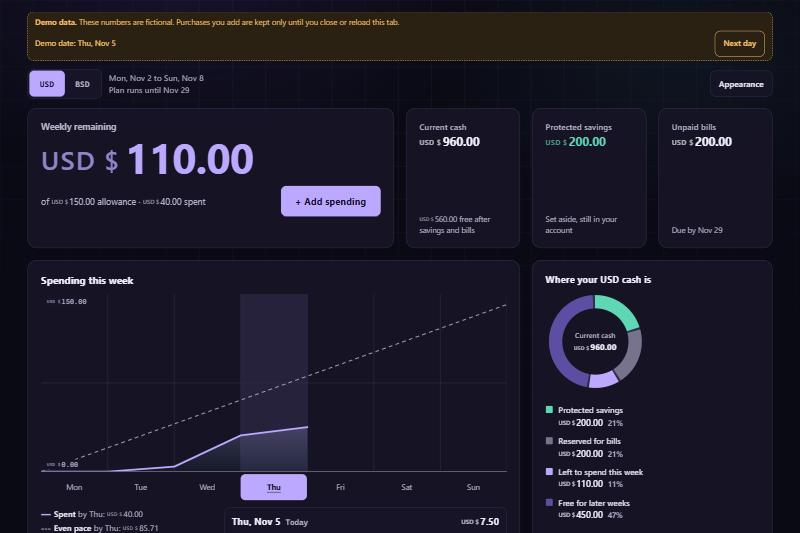
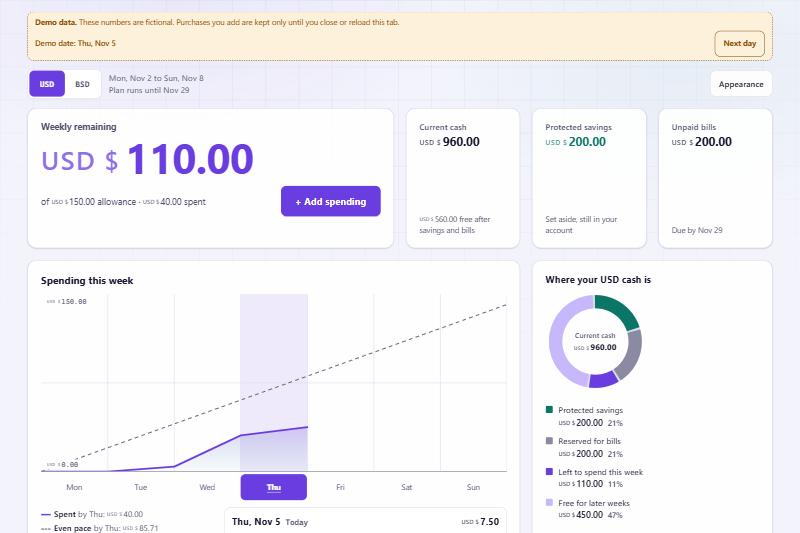
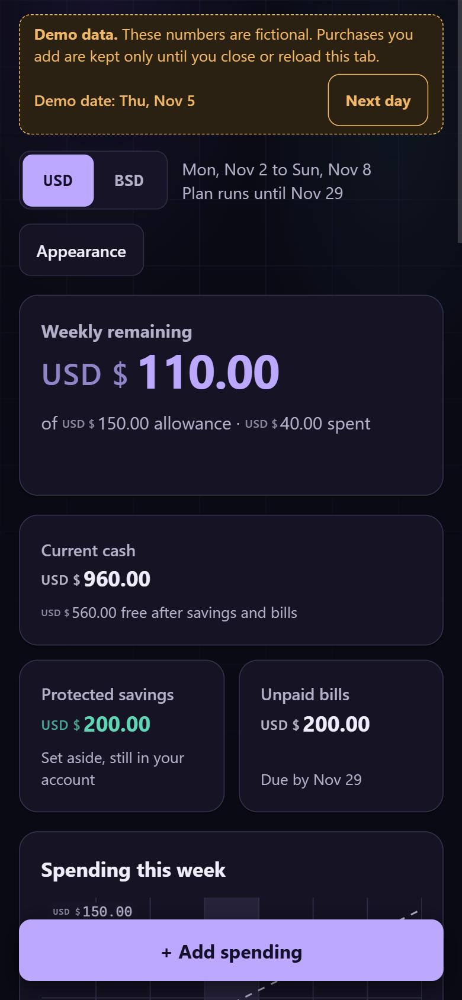

# SpendSense

A phone-first spending tracker for students whose income doesn't show up on a regular schedule.

Most budgeting apps assume a steady paycheck. SpendSense asks a smaller question: based on the money you actually have right now, how much can you spend this week? You log a purchase and that number updates.

It's still in development. It isn't deployed yet, and the first test will be a small guided beta with two or three students.



All the numbers in these screenshots come from the built-in fictional demo.

| Light mode | Phone |
| --- | --- |
|  |  |

## What it does

- Works out a weekly allowance from your cash, savings, unpaid bills and how long until your plan ends
- Lets you change that allowance, and shows what the change does to the rest of your plan
- Tracks spending, income and dated bills, including paying part of a bill
- Keeps USD and BSD as separate accounts. It never adds them together or converts between them
- Moves unused allowance into protected savings when a week closes, and only releases it when you say so
- Only counts money you have actually received, so an expected payment does nothing until it arrives
- Lets you correct your balance with a labelled entry instead of quietly changing history
- Shows the full arithmetic behind the number, so you can check it yourself
- Lets you export your data or delete your account

## What it doesn't do

No bank connections, payments, CSV import, currency transfers, debt tracking or AI features. You enter everything by hand, so the numbers are only as current as what you've entered. Protected savings is a label too. No money actually moves.

## Stack

React 19, TypeScript and Vite on the front end, with CSS Modules for styling and Motion for animation. Supabase handles the Postgres database and Google sign-in. Tests run on Vitest.

I went with Vite over Next.js because there's no need for server rendering or SEO here.

## How it's put together

```
src/domain      money and date rules, with no React or database code
src/features    the screens
src/data        all database access goes through here
src/auth        sign-in and account controls
src/ui          shared pieces like the appearance settings and panel tilt
supabase/       migrations and the database access tests
scripts/        restoring a student from their export
```

A few decisions worth pointing out:

Money is stored as whole cents, so there's no floating point. 10.50 is always 1050.

The browser checks the rules for quick feedback, but the database is what enforces them. Row-level security keeps each student's data to themselves. Closing a week, releasing savings and changing an allowance run as database functions in one transaction, so a retry or a second tab can't apply the same change twice.

A save has to succeed before the screen changes, so a failed save can't look like it worked.

The access tests sign in as two different users against a real database and try to read and change each other's data.

## Running it

You need Node 26 and npm.

```bash
npm install
npm run dev
```

Then open http://localhost:5173. In development there's a button to try the fictional demo, which doesn't need an account.

To use real accounts, create a Supabase project, run everything in `supabase/migrations/` in order, set up Google sign-in in the dashboard, and add this to a `.env.local` file:

```
VITE_SUPABASE_URL=
VITE_SUPABASE_PUBLISHABLE_KEY=
```

[`supabase/RESTORE.md`](supabase/RESTORE.md) covers rebuilding a project from scratch and restoring a student's data.

## Tests

```bash
npm test          # unit tests, no network needed
npm run test:db   # database access tests, needs a test project in .env.test
npm run build     # type check and production build
npm run lint
```

`.env.test.example` lists what the database tests need. They create throwaway users, so only point them at a project you don't care about.

## How I built this

I built this with Claude Code as a way to get better at the fundamentals: state, APIs, databases, testing and deployment. Claude wrote most of the code. I set the scope, made the product and design decisions, clicked through the features myself and sent back what didn't feel right. `PRODUCT_PLAN.md` has the original plan.

## Status

Next up is setting up a separate project for the beta and deploying it. After that, CSV import if the beta shows people actually keep using it.
